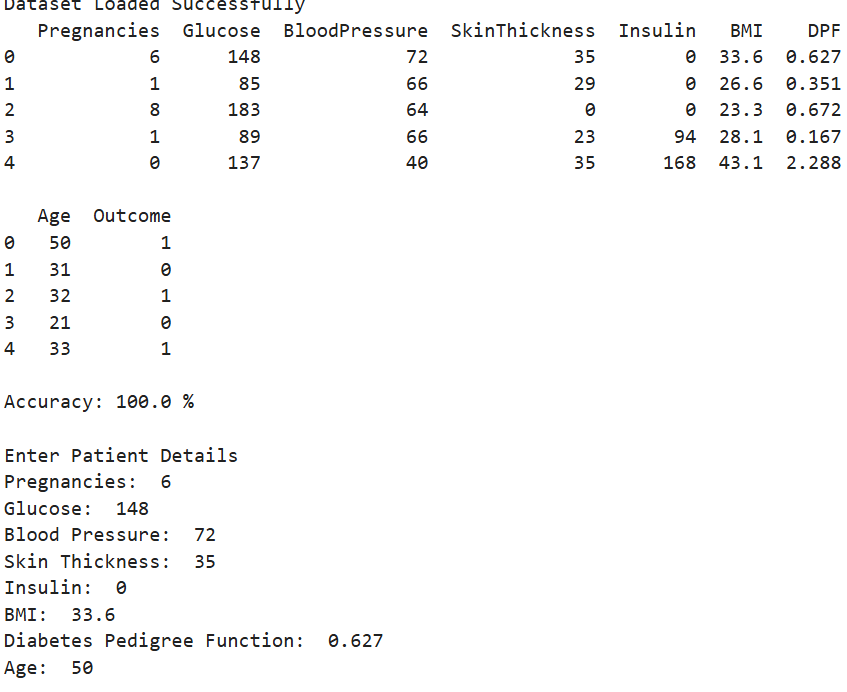
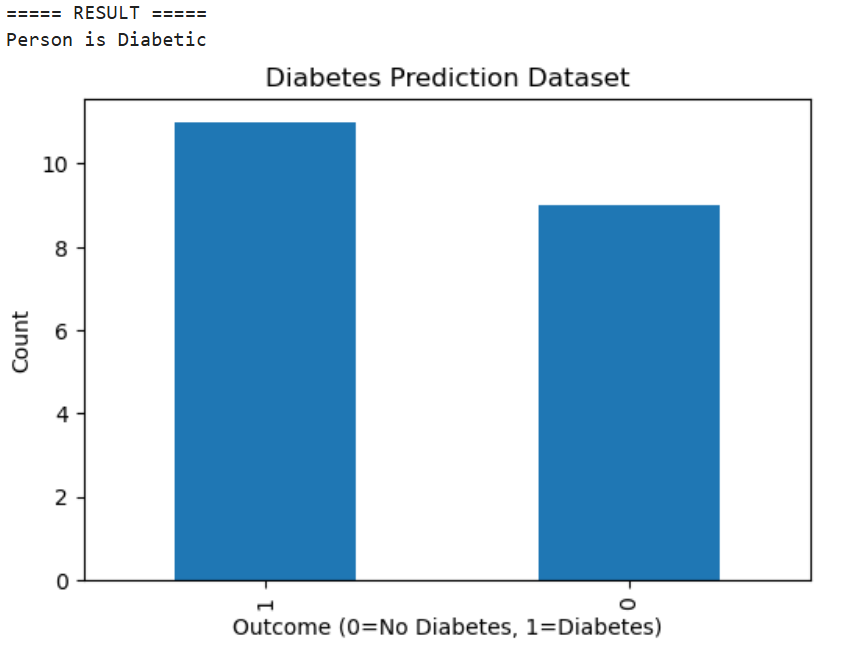

# Diabetes Prediction Using Machine Learning

## Project Description

This project predicts a diabetes class using a Machine Learning classification model. It uses patient health attributes such as glucose level, blood pressure, BMI, age, and other measurements to generate a prediction.

The model is built using **Python and Logistic Regression**, with Pandas for data handling and Matplotlib for visualization.

## Technologies Used

- **Python** – Programming language
- **Pandas** – Data manipulation and analysis
- **NumPy** – Numerical computing
- **Matplotlib** – Data visualization
- **Scikit-learn** – Model training, testing, and evaluation
- **Logistic Regression** – Classification algorithm
- **Jupyter Notebook** – Development environment

## Features

- Creates and processes a sample diabetes dataset.
- Splits the dataset into training and testing sets.
- Trains a Logistic Regression classification model.
- Evaluates model accuracy.
- Accepts patient details as user input.
- Predicts a diabetes class using the trained model.
- Displays a bar chart showing the outcome distribution.

## Project Files

- `Diabetes_Prediction_ML.ipynb` – Diabetes prediction code, model training, and visualization.
- `python with data science.ipynb` – Python and Data Science practice.
- `python with data science2.ipynb` – Additional practice notebook.

## Installation

Install the required Python libraries:

```bash
pip install pandas numpy matplotlib scikit-learn jupyter
```

## How to Run

1. Clone this repository:

   ```bash
   git clone https://github.com/Arya-gunji/python-with-data-scenice.git
   ```

2. Open the project folder:

   ```bash
   cd python-with-data-scenice
   ```

3. Start Jupyter Notebook:

   ```bash
   jupyter notebook
   ```

4. Open `Diabetes_Prediction_ML.ipynb`.
5. Run the notebook cells in order.
6. Enter the requested sample patient details to view the model prediction.

## Output


### Model Output



### Diabetes Prediction Chart




## Project Link

[View Diabetes Prediction Notebook](https://github.com/Arya-gunji/python-with-data-scenice/blob/main/Diabetes_Prediction_ML.ipynb)

[View GitHub Repository](https://github.com/Arya-gunji/python-with-data-scenice)

## Author

**Arya Gunji**

GitHub: [Arya-gunji](https://github.com/Arya-gunji)

## Disclaimer

This project is intended for educational purposes only. The dataset contains only 20 sample records, so the model is not suitable for real-world medical diagnosis or treatment decisions.
